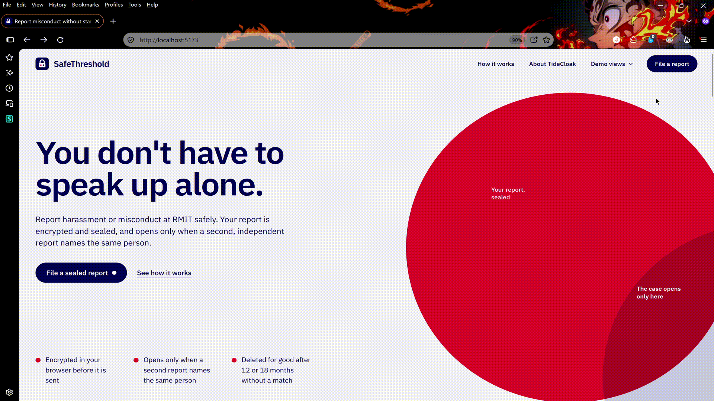

# SafeThreshold

SafeThreshold is an anonymous escrow platform for reporting misconduct. A report stays sealed until at least two independent people report the same subject. No school, IT admin or AI can open a single report on its own.

Team *Me & the Bums*, RMIT Hackathon 2026, Challenge 2.

## 1. Vision & originality

SafeThreshold is a "sealed report escrow". A report is encrypted and held until a second, independent report about the same person appears. Only then is the full file decrypted and handed to an independent investigator.

The core idea is that nobody stands alone. The first reporter is fully protected from exposure and retaliation until there is collective evidence.

## 2. Trust constraint insight

People who are harassed, bullied or abused by someone with power fear three things:

- Their identity being exposed.
- Retaliation.
- The report being buried, or read in secret, by the organisation they are reporting.

Traditional channels (internal forms, hotlines, vendor software) share one weakness: whoever runs the system holds the keys or has full backend access. They can read, filter, delete or delay any report.

SafeThreshold removes that control. No server, admin or AI ever holds a decryption key.

## 3. Value & impact

- A student harassed by a lecturer can report without being exposed until a second person comes forward.
- If nobody else reports the same subject, the report stays sealed forever or is deleted.
- When a second report arrives, both files open together and go to an independent investigator.
- Repeat offenders are found earlier, before they harm more people.
- It can extend to student-to-student, staff-to-leadership, and other hierarchical organisations (hospitals, NGOs, companies).

## 4. Why steward-held shares matter

With a normal login plus backend, the admin is the trust hole. Here each report is encrypted in the reporter's browser with its own key, and that key is split with Shamir sharing across the stewards (for example 2 of 3). Each share is wrapped to one steward's public key, so the server stores only ciphertext and wrapped shares. A case opens only when enough stewards re-wrap their shares to the assigned investigator, on their own devices.

## 5. How it works

| Mechanism | Behaviour |
|---|---|
| Client-side encryption | The report is encrypted on the user's device before it is sent. |
| Anonymous matching | Each report produces a blinded token from the subject's identifier, normalised name and unit. The token is only used for matching and is never exposed. Two matching tokens make the case *eligible*. |
| Withdrawal | The reporter can delete their report completely before the threshold. After it, withdrawal is not possible (or limited to removing personal identity details). |
| Expiry | Reports live at most 12–18 months. If the threshold isn't reached, the ciphertext is permanently deleted. |
| Steward quorum | The key is shared across nodes. Only a quorum of independent stewards (e.g. 2/3 or 3/5) can release it. Stewards never see the content before decryption. |

### Design decisions

| Item | Decision | Notes |
|---|---|---|
| Matching | Blinded token from subject identity | Needs collision and dictionary-attack resistance |
| Withdrawal | Free before threshold, restricted after | |
| Retention | 12–18 months | Configurable per organisation |
| Stewards | 3–5, chosen by the organisation, can rotate | Student Union + NGO + oversight body |
| Admin / server | Never holds plaintext or a full key | |
| Reporter identity | Anonymous until they choose to reveal | |

## 6. Prototype & demo (adversarial storytelling)

1. Student A submits a sealed report. An IT admin dumps the whole database and sees only ciphertext.
2. The admin tries to forge an approval, bribe one steward and self-promote. Every node rejects it.
3. Student B submits a report. The blinded tokens match and the case becomes *eligible*.
4. Once 2/3 of stewards approve, the nodes release the key. The investigator reads both reports at once.
5. A steward stalls. The system keeps waiting for quorum and nobody can force it.
6. Student A withdraws before the threshold. Their token disappears and the case is no longer eligible.



## 7. Risks & mitigations

| Risk | Mitigation |
|---|---|
| Cold start (no second report, trust is lost) | Pilot in a small community with a strong student union and a clear campaign |
| Steward influence | Quorum, periodic rotation, public audit log (no content) |
| False matching | Blinded tokens plus a light review after decryption |
| Fake reports | Rate limiting and light proof-of-human, keeping anonymity |
| Legal and sensitive data storage | Store ciphertext only, automatic deletion policy, clear responsibility after decryption |

## Repository layout

```
backend/    Server code and database (database/database.ts, database/migration)
frontend/   React + TypeScript + Vite app: the three portals and the escrow engine
  src/escrow/    Escrow engine: encryption, blinded tokens, key shares, node checks (tested)
  src/portals/   Reporter, Admin IT, Steward quorum & investigator, public audit log
.env.example  Required environment variables
```

## Setup

Requirements: Node.js 22+ and a Supabase project (run `backend/src/database/migration/001` to `008` in the SQL editor).

1. Copy `backend/.env.example` to `backend/.env.local` and `frontend/.env.example` to `frontend/.env.local` and fill them in (never commit them).
2. In Supabase Auth, create the staff accounts (email + password) or invite them.
3. Seed one org and its first org admin (see `006_admin.sql`), then run both servers from the repo root:

```bash
npm install && npm run dev   # API :3000, web http://localhost:5173
```

`npm test`, `npm run build` and `npm run lint` run in `frontend/`. The test flows are in [docs/testing.md](docs/testing.md).

Press **Esc** (or *Quick exit*) on the reporter portal to leave for google.com immediately.

### Not built yet

- Steward rotation: shares of existing reports are wrapped to the stewards of the day, so a new steward cannot read them. See [docs/key-custody.md](docs/key-custody.md).
- Production blinding: the matching token is keyed with a server-held pepper; a threshold OPRF would remove that single secret.
- Proof-of-human for reporters that preserves anonymity.
